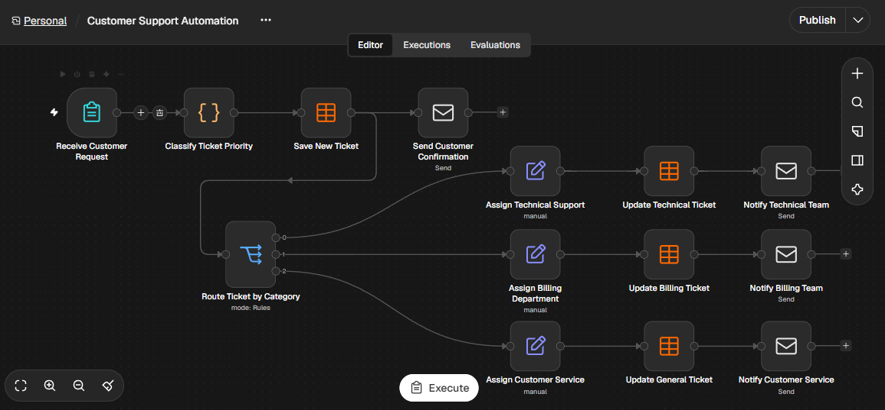
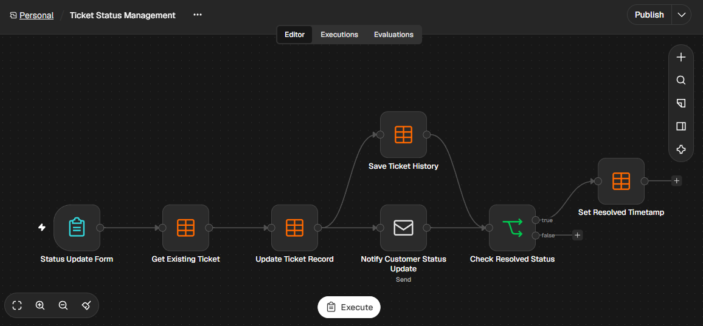
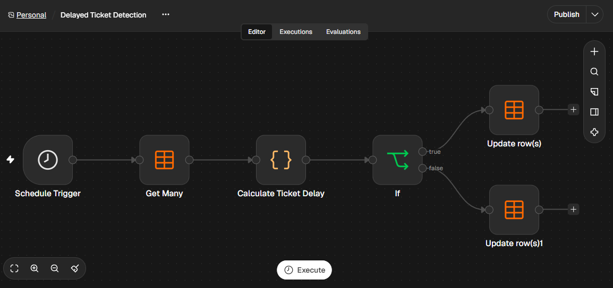
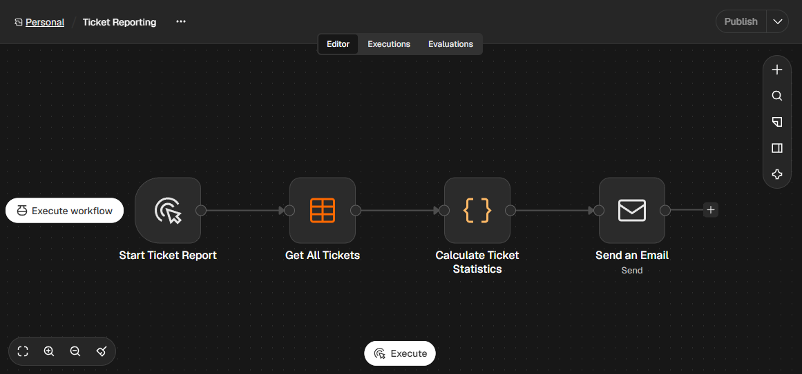

Overview:

Customer Support Automation is a workflow-based system built with n8n to automate customer support operations and ticket management.

The system receives customer requests, automatically classifies ticket priorities, assigns tickets to the appropriate support teams, and sends email notifications.

It also provides ticket status management, tracks delayed tickets, maintains ticket history, and generates automated reports for managers.

The goal of this project is to reduce manual work, improve response efficiency, and provide better visibility into customer support operations.

Features:

- Automated Ticket Creation: Receives and stores customer support requests automatically.
- Priority Classification: Classifies tickets as Normal, Important, or Urgent based on customer messages.
- Team Assignment: Automatically assigns tickets to the appropriate support department.
- Email Notifications: Sends confirmation emails to customers and notifications to support teams.
- Ticket Status Management: Allows support agents to update ticket statuses and add notes.
- Ticket History: Records status changes and agent notes for tracking purposes.
- Delayed Ticket Detection: Identifies unresolved tickets that have been open for more than three days.
- Automated Reporting: Calculates ticket statistics and sends reports to managers.

## Project Highlights

- Automated Business Logic: Uses JavaScript to classify customer tickets based on predefined keywords.
- Priority-Based Processing: Separates Normal, Important, and Urgent support requests.
- Automated Team Routing: Assigns tickets to Technical Support, Billing Department, or Customer Service.
- Status Tracking: Maintains ticket status and records changes in a separate history table.
- Scheduled Monitoring: Automatically detects unresolved tickets older than three days.
- Management Insights: Generates daily reports with ticket statistics and performance metrics.
- Modular Architecture: Separates ticket creation, status management, monitoring, and reporting into four workflows.

 Workflows:

This project consists of four independent workflows:

1. Customer Support Automation

- Receives customer support requests through a form.
- Classifies ticket priority using JavaScript.
- Stores ticket information in the database.
- Assigns tickets to the appropriate support teams.
- Sends email notifications to customers and support teams.

2. Ticket Status Management

- Allows support agents to update ticket statuses.
- Stores agent notes.
- Records status changes in the ticket history.
- Updates the resolution timestamp when a ticket is resolved.
- Notifies customers about status updates.

3. Delayed Ticket Detection

- Runs automatically every day.
- Checks how long tickets have been open.
- Identifies unresolved tickets older than three days.
- Updates the delayed status of each ticket.

4. Ticket Reporting

- Retrieves all stored tickets.
- Calculates ticket statistics and resolution rates.
- Calculates delayed ticket rates.
- Generates a summary report.
- Sends the report to the manager via email.

 Technologies Used:

- n8n: Workflow automation and orchestration.
- JavaScript: Data processing and ticket priority classification.
- n8n Data Tables: Data storage and ticket history management.
- SMTP / Gmail: Automated email notifications and reporting.

 Database Structure:

The project uses two n8n Data Tables to store and manage information.

1. CustomerTickets

Stores the main information of each customer support ticket, including:

- Ticket ID
- Customer name and email
- Subject and problem description
- Category and priority
- Ticket status
- Assigned support team
- Agent notes
- Creation and update timestamps
- Resolution timestamp
- Delayed ticket indicator

2. TicketHistory

Stores the history of ticket status changes, including:

- Ticket ID
- Action
- Previous status
- New status
- Agent note
- Change timestamp

## Documentation

Detailed project documentation is available in the following files:

- [Project Description](project_description.md)
- [Technical Documentation](documentation/technical_documentation.md)

These documents explain the project architecture, workflow logic, database structure, implementation details, and setup requirements.

 Installation & Setup:

Prerequisites

Before running the workflows, make sure you have:

- A running n8n instance.
- Access to n8n Data Tables.
- An SMTP email account and configured credentials.

Setup Steps

1. Download or clone this repository.
2. Import the workflow JSON files into your n8n instance.
3. Configure the required email credentials.
4. Make sure the required Data Tables are available.
5. Review the workflow settings and form configurations.
6. Execute the workflows and test the automation process.

## Screenshots

### 1. Customer Support Automation

### 2. Ticket Status Management

### 3. Delayed Ticket Detection

### 4. Ticket Reporting

